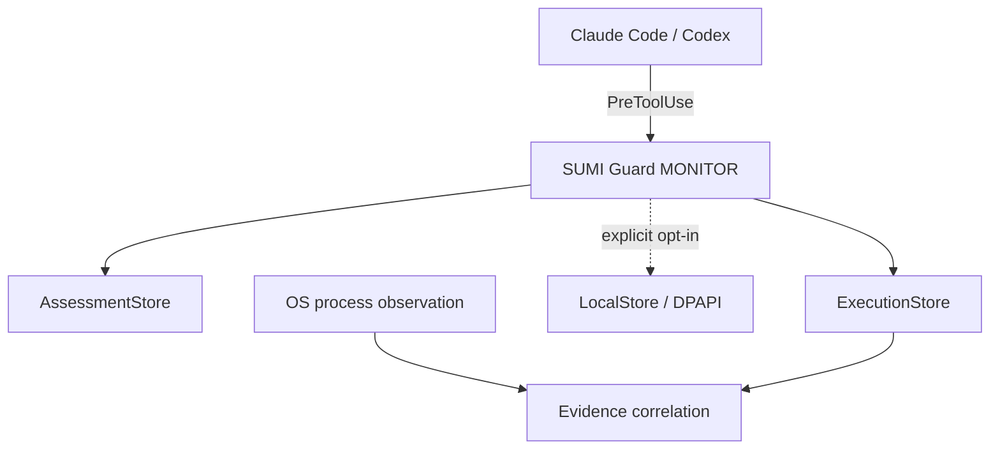

# SUMI Guard

[](https://github.com/ponponpon888/sumi-guard/actions/workflows/windows-powershell-5.1-check.yml)

**A local-first audit prototype for Claude Code and Codex pre-tool events on Windows.**

[日本語](README.md) · [Security](SECURITY.md) · [Threat model](THREAT_MODEL.md) · [Claude Code compatibility](docs/28-claude-code-hook-compatibility.md)

SUMI Guard records host-supplied pre-execution input, assessment output, and independent OS process observations as separate evidence types. Its MONITOR hook never denies execution. Metadata-only recording is the default, so command bodies are not stored unless explicitly enabled.

> SUMI Guard is an audit prototype, not antivirus or endpoint protection. A pre-tool event is not proof that a command ran, and `NO_DETECTION` does not mean safe or malware-free.

## What it does

- Accepts profile-specific `PreToolUse` input from Claude Code and Codex
- Assesses PowerShell source without executing it
- Separates execution-event metadata from assessment records
- Stores SHA-256 and required metadata by default, not the command body
- Uses Windows DPAPI CurrentUser and a restricted ACL when body capture is explicitly enabled
- Correlates application events with OS observations without overstating evidence strength

## Architecture



## Verified paths

| Host | Environment | Verified |
|---|---|---|
| Claude Code | 2.1.304 / Windows PowerShell 5.1 | Hook reachability, strict UTF-8 including Japanese and emoji, one execution record, one assessment record, no body container, no raw-command leak |
| Codex | Disposable child session on Windows | Real `PreToolUse`, ExecutionAdapter, LocalStore, independent OS observation, `INFERRED_MATCH` |
| GitHub Actions | Windows PowerShell 5.1 | Syntax, encoding, PSScriptAnalyzer, and DPAPI-independent synthetic tests |

The Claude Code live test ran on 2026-10-20 with project-local settings and temporary initialized stores. It did not use an operational store, a permanent hook, or global Claude settings.

## Three-minute isolated demo

```powershell
git clone https://github.com/ponponpon888/sumi-guard.git
Set-Location .\sumi-guard

powershell.exe -NoLogo -NoProfile -ExecutionPolicy Bypass `
  -File .\demo\Start-SumiGuardDemo.ps1

powershell.exe -NoLogo -NoProfile -ExecutionPolicy Bypass `
  -File .\demo\Show-SumiGuardDemo.ps1

# Explicit cleanup after inspection
powershell.exe -NoLogo -NoProfile -ExecutionPolicy Bypass `
  -File .\demo\Clear-SumiGuardDemo.ps1 -ConfirmDemoRemoval
```

The demo uses only fixed benign input and writes under `.demo-data`, which is excluded from Git. Review [demo/README.md](demo/README.md) before running it.

## Security boundaries

- MONITOR is the default; the hook does not automatically deny or block execution.
- DPAPI CurrentUser and ACLs do not protect against the same Windows user, administrators, or a compromised user session.
- Polling-based OS observation may miss short-lived processes.
- Never put secrets, credentials, or real command bodies in public issues.

See [SECURITY.md](SECURITY.md), [THREAT_MODEL.md](THREAT_MODEL.md), and the detailed [Japanese README](README.md).

## Author

**Shingo Kumon**

- [GitHub](https://github.com/ponponpon888)
- [Web](https://www.shingokumon.com)
- [X](https://x.com/shingo_kumon)
- [Contact](https://www.shingokumon.com/contact)
