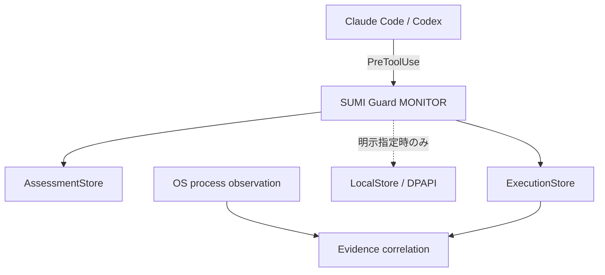

# SUMI Guard

[](https://github.com/ponponpon888/sumi-guard/actions/workflows/windows-powershell-5.1-check.yml)


**Claude Code / Codex が送ったツール実行前イベントを、Windows 上でローカル監査するオープンソース試作です。**

[English](README.en.md) · [Security](SECURITY.md) · [Threat model](THREAT_MODEL.md) · [Claude Code compatibility](docs/28-claude-code-hook-compatibility.md)

SUMI Guard は、AI 開発ツールから渡された実行前入力、ルール評価、独立した OS プロセス観測を
別々の証拠として記録します。MONITOR フックは実行を遮断せず、コマンド本文を保存しない
`MetadataOnly` が既定です。

> SUMI Guard は監査用プロトタイプです。ウイルス対策、侵入防止、実行成功の証明、100% の捕捉を
> 提供しません。`NO_DETECTION` は「対応ルールに一致しなかった」という意味で、安全判定ではありません。

## できること

- Claude Code と Codex の `PreToolUse` 入力をプロファイル別に受け取る
- PowerShell ソースを実行せずにルール評価する
- 実行イベントと評価結果を分離してローカル保存する
- MONITOR フックでは本文を既定で保存せず、SHA-256 と必要なメタデータだけを記録する
- 本文を明示保存する場合は Windows DPAPI CurrentUser と専用 ACL を使用する
- OS プロセス観測とアプリイベントを、証拠の強さを保ったまま照合する

## 仕組み



実行前入力は「実際にコマンドが実行された証明」ではありません。対象 PID がホストイベントに
含まれない経路では、OS 観測との対応は `DIRECT_MATCH` ではなく `INFERRED_MATCH` になります。

## 実機で確認済み

| Host | Environment | Verified |
|---|---|---|
| Claude Code | 2.1.304 / Windows PowerShell 5.1 | `PreToolUse` 到達、UTF-8 日本語・絵文字、Execution/Assessment 各1件、本文容器0件、生コマンド漏えい0件 |
| Codex | 使い捨て子セッション / Windows | 実 `PreToolUse`、ExecutionAdapter、LocalStore、独立 OS 観測、`INFERRED_MATCH` |
| GitHub Actions | Windows PowerShell 5.1 | 構文、文字コード、PSScriptAnalyzer、DPAPI 非依存の合成試験 |

Claude Code の限定接続試験は 2026-10-20 に実施しました。フック応答は
`evaluation=UNASSESSABLE`、`assessment_storage=SAVED`、
`intent_storage=EVENT_SAVED_METADATA_ONLY` で、MONITOR として実行を継続しました。
詳しい条件と証拠は [docs/28](docs/28-claude-code-hook-compatibility.md) を参照してください。

## 強制モードへの安全ゲート

既定の MONITOR は、記録するだけで実行を止めません。「記録できない操作は実行させない」
強制モード（`ENFORCE_RECORDING`、設計は [docs/26](docs/26-enforce-recording-design.md)）は、
次の4つのゲートを順に通すまで、どこからも有効にしません。各ゲートは測定記録を残して閉じます。

| ゲート | 確かめること | 状態 | 記録 |
|---|---|---|---|
| 1. 判定と応答 | 記録の成否から deny / allow を決める判定と、Claude Code へ返す deny 応答の形（合成試験） | 完了（CI） | [docs/33](docs/33-recording-enforcement-decision-stage.md), [docs/34](docs/34-claude-pretooluse-response-prototype.md) |
| 2. ホストが deny に従うか | 本物の Claude Code が SUMI Guard の deny で実行を止め、無関係な操作は止めないか（使い捨てセッション、無害な固定入力） | 完了（Claude Code 2.1.309、2026-10-23）。Codex は未測定 | [測定記録](measurements/2026-10-23-claude-pretooluse-deny-gate2.md) |
| 3. 暗号化と権限 | 運用者の Windows で、DPAPI CurrentUser、ACL、保存失敗時の継続、記録の出どころ（使い捨て保存先） | 完了（31/31 項目、2026-10-27） | [測定記録](measurements/2026-10-27-gate3-operator-check.md) |
| 4. 運用の安全装置 | 運用者だけが置ける設定、緊急停止スイッチ、待ち時間の上限、通知。その後、1経路だけで有効化して測定 | 進行中（部品と強制フックは完了、実機測定待ち） | [docs/33](docs/33-recording-enforcement-decision-stage.md), [docs/36](docs/36-gate4-enforcement-control.md), [docs/37](docs/37-gate4-enforcement-hook.md) |

ゲート4が閉じるまで、`hooks/Invoke-SumiGuardMonitorHook.ps1` は常に MONITOR のままです。

## 3分デモ

Windows PowerShell 5.1 で、固定の無害な入力だけを使う隔離デモです。

```powershell
git clone https://github.com/ponponpon888/sumi-guard.git
Set-Location .\sumi-guard

powershell.exe -NoLogo -NoProfile -ExecutionPolicy Bypass `
  -File .\demo\Start-SumiGuardDemo.ps1

powershell.exe -NoLogo -NoProfile -ExecutionPolicy Bypass `
  -File .\demo\Show-SumiGuardDemo.ps1

# 確認後、明示的にデモデータを清掃
powershell.exe -NoLogo -NoProfile -ExecutionPolicy Bypass `
  -File .\demo\Clear-SumiGuardDemo.ps1 -ConfirmDemoRemoval
```

デモは `.demo-data` だけを使用し、Git 管理対象や通常運用ストアへ書き込みません。開始前に
[demo/README.md](demo/README.md) の隔離条件を確認してください。

## セキュリティ境界

- 既定は MONITOR であり、自動 deny や自動遮断を行いません。
- 同じ Windows ユーザー、管理者、侵害済みセッションからの読取り・改変・削除は防げません。
- OS 観測はポーリング方式のため、短命プロセスを取り逃す可能性があります。
- 実データや認証情報を含む Issue を公開しないでください。

詳細は [SECURITY.md](SECURITY.md) と [THREAT_MODEL.md](THREAT_MODEL.md) にあります。

---
## 現在の状態

現在は、無害な固定入力だけで検証した監視試作です。通常実行、後続標準入力、MONITORモードでの
保存失敗という既存3ケースを検証し、アプリ記録とOS記録の `INFERRED_MATCH` まで確認済みです。
フックイベントに対象PIDがないため、`DIRECT_MATCH` を確認したものではありません。

別の固定入力1件では、実際のCodex `PreToolUse` からExecutionAdapterとLocalStoreへ接続し、本文の
暗号化保存、明示復号、独立したOS観測、別イベントの実行結果までを `INFERRED_MATCH` で確認しました。
これは使い捨て子Codexセッションだけの接続試験であり、通常運用への接続ではありません。

2026-10-20 には Claude Code 2.1.304 のプロジェクトローカル `PreToolUse` から限定接続し、
Windows PowerShell 5.1 へのフック到達、厳密な UTF-8 復号、ExecutionStore と AssessmentStore への
メタデータ保存、本文非保存を確認しました。運用ストア、恒久フック、グローバル設定は使用していません。

次の制約があります。

- 起動後に `write_stdin` で渡される後続標準入力の本文は取得できません。
- OS観測はポーリング方式であり、短命なプロセスを取り逃す可能性があります。
- 常駐監視、感染判定、誤検知判定、自動遮断は未実装です。
- 現在の結果は固定入力による試作検証であり、一般のコマンドや実データに対する完全性を保証しません。

## 構成

- `kit/sumi-guard-prototype/`: 検証済みPowerShell 5.1スクリプトと使用方法
- `kit/sumi-guard-protected-hook-test/`: 実フックと暗号化保存を結ぶ一回限りの接続試験
- `demo/`: 固定入力を開始・確認・清掃する手動デモ
- `src/SumiGuard.LocalStore/`: 独立したDPAPI CurrentUserローカル保存モジュール
- `src/SumiGuard.ExecutionAdapter/`: 実行前イベントと暗号化本文を `execution_id` で結ぶ接続モジュール
- `tests/Invoke-LocalStoreTests.ps1`: ローカル保存モジュールの単体試験
- `tests/Invoke-ExecutionAdapterIntegrationTests.ps1`: 合成イベントだけを使う接続統合試験
- `hooks/Invoke-SumiGuardMonitorHook.ps1`: Codex PreToolUse を保存前に評価し、評価結果だけを別保存する運用フック（MONITOR、denyしない）
- `tests/Invoke-ClaudeMonitorHookProfileSyntheticTests.ps1`: Claude Code プロファイル、識別子、origin、経路宣言の合成試験
- `tests/Invoke-MonitorHookStandardInputEncodingTests.ps1`: Codex / Claude 両プロファイルの厳密な UTF-8 stdin 回帰試験
- `docs/28-claude-code-hook-compatibility.md`: Claude Code 互換性、登録条件、実ホスト接続試験の記録
- `tests/Invoke-MonitorHookSyntheticTests.ps1`: 運用フックの合成試験。固定文字列だけを渡し、本文保存の実経路は置き換える
- `tools/Show-SumiGuardRecords.ps1`: 本文を復号しない保存済み記録の読み取り専用CLI
- `src/SumiGuard.ExecutionAdapter/SumiGuard.ExecutionAdapter.ReadOnly.psm1`: 既存ロックを共有読取りで開くReadOnly派生モジュール
- `src/SumiGuard.ExecutionAdapter/SumiGuard.ExecutionAdapter.ReadOnly.psd1`: ReadOnly派生モジュールの公開関数を読取り用2件に限定するmanifest
- `tools/Show-SumiGuardRecords.ReadOnly.ps1`: ReadOnly派生モジュールを明示使用するCLI
- `demo/Show-SumiGuardDemo.ReadOnly.ps1`: ReadOnly CLIを使うデモ表示
- `tests/Invoke-ReadOnlyCliTests.ps1`: 読み取り専用CLIの合成データ試験
- `tests/Invoke-ExecutionAdapterMetadataLogLimitTests.ps1`: メタデータログ16MiB上限の境界・同時追記・失敗通知満杯・retention途中失敗の合成試験
- `tests/Invoke-ManagedPowerShellAssessmentRunnerSyntheticTests.ps1`: 無害な子プロセス8ケースで、出力の捕捉・JSON読取り・事後照合の分岐と理由を判定する合成試験
- `docs/19-sumi-guard-execution-audit.md`: 設計書
- `docs/20-local-store.md`: 保存形式、容量、保持、制約
- `docs/21-execution-localstore-adapter.md`: 接続API、状態、失敗時の扱い
- `docs/22-read-only-cli.md`: 読み取り専用CLIの操作、状態、相関、制約
- `.github/workflows/windows-powershell-5.1-check.yml`: Windows PowerShell 5.1 での構文・文字コード・静的解析・合成入力試験の継続的検査
- `.github/scripts/Invoke-SumiGuardSyntaxCheck.ps1`: 全PowerShellファイルを実行せず構文解析し、非ASCIIのBOM欠落を検出する検査
- `.github/scripts/Invoke-SumiGuardAnalyzerCheck.ps1`: PSScriptAnalyzer をError深刻度と、ルール別の基準値超えで失敗させる検査
- `.github/analyzer-baseline.json`: 現在抱えているルール別件数の基準値。超えたら失敗、下回ったら下げる
- `.github/scripts/Invoke-SumiGuardCiTestSuite.ps1`: DPAPI非依存の試験だけを実行し、除外理由を保持するランナー
- `docs/25-ci-windows-powershell-check.md`: 継続的検査の範囲、言えないこと、除外した試験と理由
- `docs/26-enforce-recording-design.md`: 記録失敗時に実行を拒否する強制モードの設計（未実装、既定は MONITOR）
- `docs/27-core-privacy-review-summary.md`: PR #8/#9/#10の統合レビューとマージ記録。対象SHA、証拠の帰属、戻し方
- `SECURITY.md`: 脆弱性報告の窓口、対象範囲、秘密情報を含めない報告方法
- `THREAT_MODEL.md`: 保護対象、境界、脅威ごとの制御・試験・残余リスク
- `CONTRIBUTING.md`: 小さな変更、合成データ、隔離検証の開発規約
- `measurements/2026-10-17-ci-windows-powershell-check.md`: 継続的検査の初回測定結果
- `measurements/2026-10-17-monitor-hook-synthetic-tests.md`: 運用MONITORフックの合成試験結果（本文保存の実経路は未検証）
- `measurements/2026-10-17-assessment-origin-hook-value.md`: フック記録の `evaluation_origin` 追加の測定結果（実運用フックからの動作は未検証）
- `measurements/2026-10-18-empty-catch-policy-and-verb-rename.md`: 空のcatch方針の判断と内部例外関数の改名の測定結果（デモとキットの失敗経路は未実行）
- `measurements/2026-10-03-sumi-guard-prototype.md`: 最小試作の測定結果
- `measurements/2026-10-03-sumi-guard-final-code-correspondence.md`: 最終コードと測定結果の対応確認
- `measurements/2026-10-03-local-store-module-tests.md`: 保存モジュールの単体試験結果
- `measurements/2026-10-03-execution-localstore-integration-tests.md`: 接続統合試験と最終ハッシュ
- `measurements/2026-10-03-protected-hook-integration-test.md`: 実フック・暗号化保存・OS観測の測定結果
- `measurements/2026-10-03-read-only-cli-tests.md`: 読み取り専用CLIの合成試験と不変性確認
- `measurements/2026-10-04-manual-demo.md`: 手動デモの実フック実行とCLI表示結果

実行方法と隔離条件は `kit/sumi-guard-prototype/README.md` を参照してください。同じ試験の再実行は、
コード変更後の対応確認など明確な必要性がある場合に限ります。

## 検証済みスクリプト

| ファイル | SHA-256 |
|---|---|
| `sumi-guard-hook.ps1` | `716009de6b2d7cf23e7cf8da227f5492b8a2c417da86b507306ee85d91ed51ec` |
| `process-observer.ps1` | `5b4509a2829b1b3d0c5ac17f47350c4238fed40474acf48c11cca9839b36d227` |
| `invoke-sumi-guard-prototype.ps1` | `f2510e810aa925a800c51f7666679c4644f25683e0cbf8d40eb568357340a9c2` |

これらの値は最終対応確認レポートと一致しています。スクリプトを変更した場合は、構文検査だけでなく
隔離した動作検証を行い、新しい測定結果とハッシュの対応を残す必要があります。

## ローカル保存モジュール

ローカル保存の保護、容量上限、明示的な保持期間清掃を、既存3スクリプトへ接続しない独立モジュール
として実装しています。常駐化、UI、AI分析、感染判定、自動遮断、`DIRECT_MATCH` 化は含みません。

```powershell
Import-Module .\src\SumiGuard.LocalStore\SumiGuard.LocalStore.psd1

$store = Initialize-SumiGuardLocalStore -Path "$env:LOCALAPPDATA\SUMI Guard\body-store"
$saved = Save-SumiGuardBody -StorePath $store.store_path -Body '架空の試験本文'
$loaded = Get-SumiGuardBody -StorePath $store.store_path -BodyId $saved.body_id

# 明示的に実行した場合だけ、既定30日を超えた管理対象本文を削除する
Remove-SumiGuardExpiredBody -StorePath $store.store_path -Confirm:$false
```

本文はDPAPI CurrentUserで暗号化され、平文へのフォールバックは行いません。保存先ACLは対象ユーザーと
SYSTEMのみに限定します。1件上限は暗号化前UTF-8本文の1MiB、合計上限は暗号化コンテナの実保存量
250MiB、保持期間は30日です。

DPAPI CurrentUserとユーザーACLは、別ユーザーからの通常アクセスを制限するためのものです。同じ
ユーザー権限で動く別プロセス、管理者、侵害済みユーザーセッションからの読み取り・改変・削除は
防止できません。復号後の本文は呼び出し元プロセスのメモリに存在します。

## 実行記録との接続

`SumiGuard.ExecutionAdapter` は、合成した実行前イベントの `execution_id`、本文SHA-256、取得状態、
LocalStoreの本文参照だけを平文メタデータへ保存します。本文を保存する経路では保存が完了してから
イベントを書き、容量超過や暗号化失敗でもMONITOR動作を継続して `COLLECTION_FAILED` を記録します。通常の一覧APIは
本文を返さず、`Read-SumiGuardExecutionBody` を明示的に呼び出した場合だけ復号します。

公開masterの既定`MetadataOnly`は**MONITORフックに適用されます**。フックは`-CaptureCommandBody`（既定off）
を指定しない限り本文を保存せず、ハッシュと必要なメタデータだけを記録します。

**直接アダプタ呼出しの契約は別です。** `Save-SumiGuardExecutionIntent`の`-MetadataOnly`は既定offの
スイッチのままで、直接呼び出した場合は従来どおり本文保存経路に入ります。この2つを同じ既定として
扱わないでください。

公開masterでは、`events.ndjson`、`failures.ndjson`、`retention.ndjson`の3種類それぞれに16MiBの上限が
あります。判定は既存の書込みロック内で、UTF-8バイト数と改行を含めた追記後サイズに対して行い、上限
ちょうどは許可、超過は追記前に拒否します。拒否時に対象ファイルのサイズと内容は変わりません。
**容量超過で削除、切詰め、自動ローテーションは行いません。** 上限に達したログは記録失敗を返し続け、
暗黙の成功や`NO_RECORD`へ格下げしません。これはLocalStoreの本文容量（1件1MiB、合計250MiB、保持30日）
とは別の指標です。

保持期間清掃では、本文削除とtombstone記録が複数ファイルにまたがり**原子的ではありません**。本文を
削除した後にretentionログへtombstoneを書けなかった場合、清掃結果は`RETENTION_CLEANUP_PARTIAL`となり、
以降その記録の参照状態は`REFERENCE_MISSING`になり得ます。成功扱いにはなりません。

合成イベントでの8件の統合試験に加え、一回限りの子Codexセッションと固定入力1件で実フック接続を
確認済みです。新しい試験は検証済みOS観測器をそのまま再利用しましたが、既存3スクリプト自体は
変更していません。通常のCodexセッション、実際の開発内容、常駐監視には接続していません。

## 保存済み記録の確認

読み取り専用CLIは、一覧、本文を表示しない詳細、保存状態を日本語で表示します。保存済み本文は
復号せず、起動時の清掃や修復も行いません。表示はSUMI Guard自身が取得した範囲に限られ、PC全体の
安全判定ではありません。

```powershell
# 一覧
.\tools\Show-SumiGuardRecords.ps1 -Action List `
  -ExecutionStorePath $executionStore -LocalStorePath $localStore

# 詳細（本文は表示しない）
.\tools\Show-SumiGuardRecords.ps1 -Action Detail `
  -ExecutionStorePath $executionStore -LocalStorePath $localStore `
  -ExecutionId $executionId -OsObservationPath $observationPath

# 使用容量、上限、保持期間、参照切れ等
.\tools\Show-SumiGuardRecords.ps1 -Action StoreStatus `
  -ExecutionStorePath $executionStore -LocalStorePath $localStore
```

公開APIがロックファイルを新規作成する動作を持つため、まだロックがない空ストアではファイルを
作成しない読取専用フォールバックを使います。詳細は `docs/22-read-only-cli.md` を参照してください。

公開masterのReadOnly派生版は、公開関数を`Get-SumiGuardExecutionRecord`と
`Get-SumiGuardCollectionFailureNotice`の2件に限定します。作成・書込み・削除・保持期限清掃・本文復号は
公開一覧から除外します。これは公開一覧の制限であり、内部関数の実行不能やOS権限境界を主張するもの
ではありません。

検証済みReadOnly派生版は、メタデータ読取り時に既存ロックを `Open / Read / FileShare.Read` で開き、
共有違反だけを上限付きで再試行します。読取り同士は共存し、既存の書込みロックとは相互排他です。
ロックが存在しない場合は作成せず、メタデータへ直接迂回せず固定の読取り失敗とします。既存通常版の
ファイルと動作は変更していません。

```powershell
# 一覧
.\tools\Show-SumiGuardRecords.ReadOnly.ps1 -Action List `
  -ExecutionStorePath $executionStore -LocalStorePath $localStore

# 検証済みデモ記録の表示（一覧 → 詳細 → 保存状態）
powershell.exe -NoLogo -NoProfile -ExecutionPolicy Bypass `
  -File .\demo\Show-SumiGuardDemo.ReadOnly.ps1
```

ReadOnly派生版は一時プロジェクトでロック5項目、合成9ケース、実表示の全条件を確認済みです。
本プロジェクトへ配置した後の実行確認はまだ行っていません。正式相関は `UNMATCHED` のままで、
元のアクセス拒否原因と子Codex標準エラーが非空だった原因も未確定です。詳細と候補SHA-256は
`measurements/2026-10-05-readonly-lock-validation.md` を参照してください。

## 手動デモ

次のコマンドは、固定の無害な入力1件をデモ専用保存先へ記録し、読み取り専用CLIで
「一覧 → 詳細 → 保存状態」の順に表示します。未定義変数や `execution_id` の手入力は不要です。

```powershell
Set-Location 'C:\Dev\sumi-guard'

# 開始
powershell.exe -NoLogo -NoProfile -ExecutionPolicy Bypass `
  -File .\demo\Start-SumiGuardDemo.ps1

# 確認
powershell.exe -NoLogo -NoProfile -ExecutionPolicy Bypass `
  -File .\demo\Show-SumiGuardDemo.ps1

# 清掃
powershell.exe -NoLogo -NoProfile -ExecutionPolicy Bypass `
  -File .\demo\Clear-SumiGuardDemo.ps1 -ConfirmDemoRemoval
```

保存先は `.demo-data` で、Git管理対象外です。開始時に既存デモを上書きせず、再実行には先行する
明示清掃が必要です。暗号化本文は開始・確認のどちらでも復号・表示しません。子Codex限定の一時
フック設定と一時プロジェクトは終了時に削除します。詳細は `demo/README.md` を参照してください。

### 1. ローカル保存の保護

- 保存対象を伏せ字後のイベント、失敗通知、必要なメタデータに限定する。
- 保存ディレクトリとファイルのWindowsアクセス権を定義し、他ユーザーからの読み取りを制限する。
- 本モジュールへ明示的に渡された本文だけをDPAPI CurrentUserで暗号化する。
- 認証情報やトークンをログへ書かないことを、書き込み前の検査と失敗状態で確認する。

### 2. 容量上限

- 1件の暗号化前UTF-8本文と、暗号化コンテナの合計実保存量に上限を設定する。
- 上限接近と上限到達を区別し、本文を含まない状態通知を残す。
- 上限到達時に暗黙の成功や `NO_RECORD` とせず、保存不能を `COLLECTION_FAILED` として扱う。
- 削除またはローテーションの対象順序と、保護対象から除外する記録を事前に定義する。

### 3. 保持期間

- コンテナヘッダーの保存時刻を起算点とし、初期値を30日にする。
- 期限切れ記録の削除手順を、実行中ファイルや整合取得中のデータと競合しない形で設計する。
- 削除件数、失敗、残存容量だけを記録し、削除対象の秘密情報を通知へ複製しない。
- 定期実行は登録せず、`Remove-SumiGuardExpiredBody` の明示呼び出しだけで清掃する。

## PowerShell source assessment only

The following command parses explicitly supplied Windows PowerShell 5.1 source in memory. It does not execute or save the source, and it does not verify an execution host.

```powershell
& "$env:SystemRoot\System32\WindowsPowerShell\v1.0\powershell.exe" -NoProfile -File .\tools\Test-SumiGuardPowerShellCommand.ps1 -CommandText 'Get-ScheduledTask'
```

Exit code `0` means evaluation completed; `2` means evaluator failure; `3` means CLI internal failure. A completed `NO_DETECTION` result means only “no match within the supported rules,” not safe.

The assessment-only CLI never executes or saves `CommandText`. It labels declared Windows PowerShell 5.1 source separately from a verified execution interpreter. It omits a whole-assessment reason when no fixed reason code exists; detected findings still show their rule ID, severity, and fixed Japanese explanation.

The CLI displays Japanese fixed warnings for detected rules, but never prints the supplied source. It is assessment-only and does not establish that any execution interpreter was verified.

## 作った人

**公門 慎吾（Shingo Kumon）** — くもん しんご

AI を使った開発で、Web サービスと業務の仕組みを作り、複数のサービスを本番で運用しています。

- ほかの作品: [GitHub プロフィール](https://github.com/ponponpon888)
- Web: [shingokumon.com](https://www.shingokumon.com) / X: [@shingo_kumon](https://x.com/shingo_kumon)
- 開発の相談（業務委託・フルリモート）: [お問い合わせ](https://www.shingokumon.com/contact)
